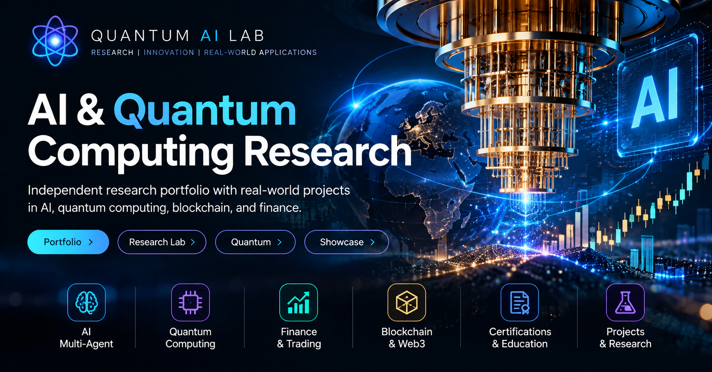

# Quantum AI Showcase

[](https://quantum-ai-showcase.vercel.app/)

Professional AI & Quantum Computing research portfolio for Tamás Németh.

## Live site

Production is deployed on Vercel from the `main` branch.

## Stack

- React 19
- TanStack Start / TanStack Router
- TypeScript
- Vite
- Tailwind CSS
- Nitro
- Vercel

## Featured projects

- AI Multi-Agent Financial Research Platform
- Quantum Finance Lab
- Quantum Portfolio Optimizer

## Development

```sh
npm install
npm run dev
```

Production build:

```sh
npm run build
```

The repository is maintained directly through GitHub and deployed with Vercel.
